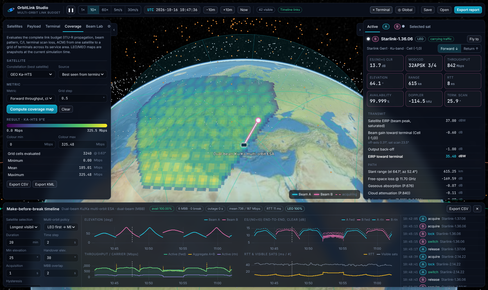
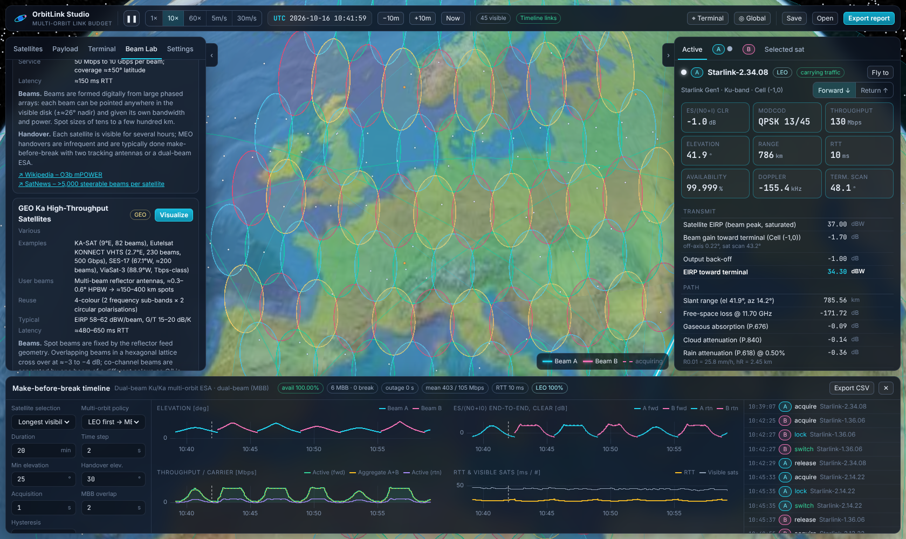
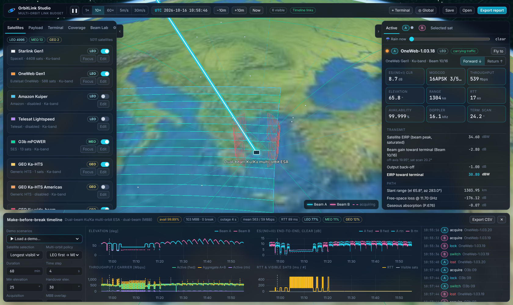
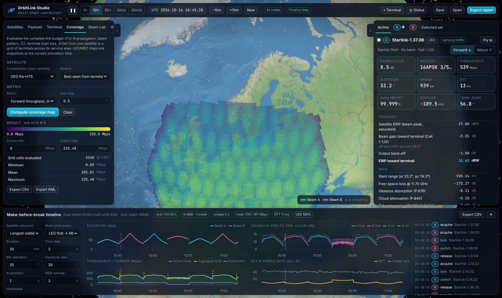

# OrbitLink Studio

**Multi-orbit (LEO / MEO / GEO) satellite link-budget analysis in the browser** — a 3D globe with
real orbital mechanics, editable payloads and beam layouts (including KML/KMZ beam contours),
ITU-R propagation, a dual-beam phased-array terminal with make-before-break handovers, coverage
maps and exportable, simulator-grade link budgets.



## Quick start

```bash
npm install
npm run dev        # http://localhost:5173
npm test           # engine tests (ITU-R models validated against ITU-Rpy)
npm run build      # static site in dist/ – host anywhere (GitHub Pages workflow included)
```

The app opens over the terminal (Athens by default) with Starlink, OneWeb, O3b mPOWER and two GEO
satellites enabled, runs a 20-minute make-before-break timeline and shows live budgets for both
terminal beams. Click the globe in **Terminal → Pick on globe** to move the terminal anywhere.

**Scenarios** (top bar → *Scenario*): one click switches the satellites, handover policy and terminal set-up, and re-runs the simulation. The GEO wide beam is always on and follows the terminal, so there is a GEO fallback anywhere.

| Demo | What it shows |
| --- | --- |
| Multi-orbit | Starlink, OneWeb, O3b mPOWER and the GEO wide beam; LEO first with MEO/GEO fallback |
| LEO make-before-break | Starlink handovers every few minutes with zero interruption |
| Multi-orbit MBB in an urban canyon | East/west sky blocked below 60°: traffic moves OneWeb → O3b mPOWER → GEO and back (≈LEO 76 % / MEO 18 % / GEO 6 %), 100 % availability |
| GEO + LEO together | Beam A parked on the GEO wide beam, beam B tracking LEO |
| MEO make-before-break (6 h) | Long O3b mPOWER passes |
| OneWeb push-broom beams | Es/N0 ripple as the 16 fixed beams sweep over the terminal |
| Single-beam terminal | The same LEO run with break-before-make outages |

**Layers** (top bar → layers icon): switch satellite dots per orbit (LEO/MEO/GEO), labels, orbit paths, coverage rings,
link lines, beam footprints, the solid serving-beam cones and field-of-view cones of the visible LEO/MEO satellites,
obstruction walls and the base map — or hide every overlay at once.

## What you can do

| Area | Capabilities |
| --- | --- |
| **Constellations** | Walker Delta/Star shells (two-body + J2 secular drift), station-kept GEO slots with residual inclination (figure-8), TLE files / pasted TLEs, **live CelesTrak TLEs** (SGP4 or fast Kepler+J2). Presets: Starlink Gen1 (4,408), OneWeb (588), Kuiper (3,236), Lightspeed (198), O3b mPOWER (13), GEO Ka-HTS Europe & Americas, GEO Ku FSS. |
| **Payload editor** | Every parameter: band, bent-pipe / regenerative, forward EIRP, OBO, C/IM, return G/T, carrier bandwidth & roll-off, polarisation, feeder-link C/N, C/ASI, X-pol isolation, min elevation, antenna pattern (phased array with cosⁿ scan loss & beam broadening, Bessel aperture, ITU-R S.672, Gaussian). |
| **Beam layouts** | Steerable spots over hexagonal ground cells (LEO/MEO ESAs) with frequency-reuse colours, co-channel load and scheduler separation · OneWeb-style fixed push-broom strips · GEO multibeam hex grid (4-colour reuse) · single spot / regional beam · **imported KML/KMZ contours** (absolute EIRP, relative dB, or beam-edge polygons). Export any layout as an operator-style EIRP-contour KML. |
| **Terminal** | Electronically steered array or parabolic dish, 1 or 2 independent beams, Ku and/or Ka bands (gain, G/T, EIRP), Rx/Tx scan-loss exponents, scan limit, panel tilt/azimuth, pointing/radome/polarisation losses, implementation margin, ground-spill noise, **obstruction mask** (azimuth sectors blocked below an elevation, drawn as walls on the globe). |
| **GEO per-beam control** | For multibeam and KML payloads: switch individual beams off, change their reuse colour, add per-beam EIRP offsets (return G/T unaffected). |
| **Weather what-if** | "Rain now" slider applies an instantaneous rain rate along the slant path (P.618 effective path) to the current-conditions budget, including the rain-noise G/T degradation. |
| **Link budget** | Forward & return line items: EIRP toward terminal, FSPL, gases, cloud, rain, scintillation, total attenuation (P.618 §2.5), rain-induced sky-noise increase, G/T at scan angle, C/N0, Es/N0, co-channel C/I from the beam geometry, C/ASI, C/XPI (antenna ∥ rain XPD), C/IM, feeder C/N, end-to-end Es/(N0+I0), DVB-S2/S2X ACM MODCOD, throughput, annual availability (inverted P.618), PFD, Doppler & Doppler rate, RTT. |
| **Make-before-break** | Dual-beam terminal state machine: beam B acquires and locks the next satellite while beam A carries traffic; traffic switches on lock; A is released after the overlap. Policies: longest visibility / max elevation / best Es/N0; multi-orbit: LEO-first → MEO → GEO, GEO/MEO + LEO dual, best throughput. Single-beam terminals fall back to break-before-make so you can quantify the outage. |
| **Coverage maps** | Gridded service-area analysis from any satellite: EIRP, Es/(N0+I0), C/I, throughput, availability, elevation — rendered as a heat-map, exportable to CSV/KML. |
| **Beam Lab** | How the beams of Starlink, OneWeb, Kuiper, Lightspeed, O3b mPOWER and GEO HTS are built, with sources, **Visualize** buttons that draw a live satellite's full beam layout, a footprint-size comparison, a beam-pattern explorer and a footprint/scan calculator. |
| **Export** | Full HTML report (both beams, forward & return, timeline summary & events), per-link CSV/JSON, timeline CSV, coverage CSV/KML, beam KML, scenario JSON save/load. |

## Screenshots

| GEO Ka-HTS multibeam (4-colour reuse) | Multi-orbit MBB in an urban canyon | Coverage map (GEO throughput) |
| --- | --- | --- |
|  |  |  |

## Propagation & models

* **ITU-R P.618-13** rain attenuation, scintillation, rain XPD, total attenuation combination, availability inversion
* **ITU-R P.676-10 Annex 2** gaseous attenuation (oxygen + water vapour, zenith water-vapour method)
* **ITU-R P.838-3** rain specific-attenuation coefficients, **P.840** cloud attenuation
* Global digital maps resampled from the ITU-R data distributed with ITU-Rpy: **P.837-7** R0.01, **P.839-4** 0 °C isotherm,
  **P.840-7** reduced cloud liquid water, **P.836-6** water vapour, **P.453-13** Nwet, **P.1511** topography (`public/itu/*.bin`, built by `scripts/build_itu_grids.py`)
* Validated against ITU-Rpy for six sites/frequencies (`src/core/itu/itu.test.ts`): rain attenuation within 1 %, gases within 2 %.
* Antenna patterns: uniform circular aperture (Bessel), ITU-R S.672 envelope, Gaussian, phased array (cosⁿ scan loss, 1/cos θ beam broadening).
* DVB-S2 / S2X MODCOD thresholds (normal frames, AWGN, QEF).

See [docs/METHODOLOGY.md](docs/METHODOLOGY.md) for equations, assumptions and limitations.

## KML / KMZ beam import

Accepted structures:

* one `<Folder>` per beam, each containing contour `<Placemark>` polygons; or
* flat `<Placemark>`s with `ExtendedData` (`beam`, `level` / `EIRP` / `G/T`) or names such as `B12 52 dBW`, `-3 dB`.

Levels above ~15 are treated as absolute EIRP (dBW), smaller values as relative gain; polygons without
levels become beam edges (choose the edge level, e.g. −3 dB or −4.5 dB). Reuse colours are auto-assigned
by graph colouring (DSATUR) and can be edited per beam. A second file with **G/T contours** (dB/K) can be
imported for the return link; beams are matched by name. Try `public/samples/ka-hts-europe-eirp.kml`.

## Architecture

```
src/core/      pure TypeScript engine (no DOM) – unit tested with Vitest
  orbit/       Kepler+J2, Walker generator, SGP4 (satellite.js), GEO station-keeping
  itu/         ITU-R propagation models + map loader
  rf/          antenna patterns, beam layouts & C/I, link budget, MODCODs
  kml/         KML/KMZ parse & export
  sim/         scenario runtime, MBB handover simulator (runs in a Web Worker), coverage maps
src/globe/     CesiumJS controller (imagery, day/night, satellites, orbits, beams, links)
src/ui/        React panels (editors, link budget, timeline charts, Beam Lab, reports)
```

Deployment: `.github/workflows/pages.yml` tests, builds and publishes `dist/` to GitHub Pages on pushes to `main`
(enable *Settings → Pages → Source: GitHub Actions*). The build uses relative paths, so it also works from any static host.

## Data & accuracy notes

Orbital shells follow public FCC/ITU filings. Payload RF values (EIRP, G/T, beamwidths, cell sizes) are
**representative estimates** reconstructed from public filings, papers and operator statements — every
value is editable so you can load your own data sheets or operator KML contours. Imagery: Esri World
Imagery (falls back to the bundled offline Natural Earth II), night lights: NASA Black Marble via GIBS.

## Accounts and cloud scenarios

The app is open to everyone. Signing in (top-right person icon) adds cloud save/load of
scenarios, available on any device. Accounts use e-mail + password via
[Supabase Auth](https://supabase.com/docs/guides/auth): passwords are hashed (bcrypt) by
Supabase and never stored or seen by this app; sessions are short-lived signed tokens.

- `src/auth/supabase.ts`: the client. The project URL and **publishable** key are public
  by design and may be committed; override them with `VITE_SUPABASE_URL` /
  `VITE_SUPABASE_PUBLISHABLE_KEY`. **Never** put a `service_role` / secret key in the app.
- `supabase/schema.sql`: the `scenarios` table with Row Level Security: each user can only
  read and write their own rows; anonymous visitors get no access. Run it once in the
  Supabase dashboard → SQL Editor.
- Dashboard → Authentication → URL Configuration: Site URL
  `https://theosioulas.github.io/LinkBudget/`, plus `http://localhost:5173/**` as a
  redirect URL for local development.
